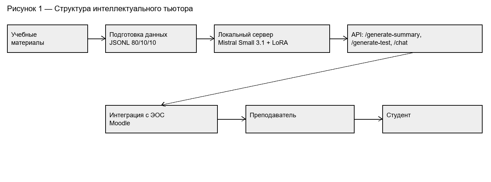

# Читаемая версия статьи для Минска (черновик, 22.11.2026)

> Статья готовится по требованиям `Minsk/docs/03_trebovaniya-k-oformleniyu-statey.md`:
> А4, поля 2,5 / 3 / 2 / 2 см, отступ 1,25, Times New Roman 10, интервал 1, до 3 страниц,
> УДК в левом верхнем углу, рисунки — в оттенках серого, оригинальность ≥ 70%, литература — не менее 4 источников.
> 23.11.2026: ФИО подставлено, DOCX собран — `№ 5. Логинов Виктор Алексеевич.docx` (численная оценка в статье дана как предварительная).

---

УДК 004.89:378.1

**СЕКЦИЯ 5. ЕСТЕСТВЕННО-МАТЕМАТИЧЕСКИЕ НАУКИ — ОСНОВА РАЗВИТИЯ ТЕХНИКИ И ТЕХНОЛОГИЙ**
**ИНТЕЛЛЕКТУАЛЬНЫЙ ТЬЮТОР НА БАЗЕ БОЛЬШИХ ЯЗЫКОВЫХ МОДЕЛЕЙ ДЛЯ СРЕДНЕГО ПРОФЕССИОНАЛЬНОГО ОБРАЗОВАНИЯ**

Логинов Виктор Алексеевич, ГБПОУ РО «СИТ», 2 курс, группа М-21
*Бардаков Дмитрий Николаевич, преподаватель технических дисциплин высшей категории, ГБПОУ РО «СИТ»*

**Введение.** Современное среднее профессиональное образование сталкивается с противоречием: объём теоретического материала непрерывно растёт, а аудиторное время, отведённое на отработку практических навыков, ограничено. Согласно ФЗ № 152-ФЗ «О персональных данных» [1], использование облачных сервисов генеративного ИИ для обучения сопряжено с риском передачи персональных данных студентов третьим лицам, а зависимость от внешних API делает учебный процесс уязвимым при потере сети и изменении тарифов провайдеров.

Большие языковые модели (LLM) на базе архитектуры Transformer [2] позволяют автоматизировать генерацию конспектов, заданий и обратной связи. Однако прямое использование публичных моделей без адаптации не гарантирует соответствия учебной программе конкретной специальности и не решает проблему конфиденциальности. Объектом исследования является процесс обучения по специальности 15.02.14, предметом — программный комплекс интеллектуального тьютора, развёрнутого на локальной инфраструктуре техникума.

Цель работы — обосновать и реализовать архитектуру интеллектуального тьютора, обеспечивающего адаптацию учебных материалов при сохранении конфиденциальности данных. Задачи: (1) сформулировать требования к системе; (2) выбрать базовую модель и метод адаптации; (3) описать алгоритм генерации учебного контента; (4) оценить качество решений на тестовой выборке. Методы — системный анализ, сравнение архитектур, эксперимент с промпт-шаблонами и последующая оценка качества ответов.

**Основная часть.** В качестве базовой модели выбран Mistral Small 3.1 (24 млрд параметров, лицензия Apache 2.0) [3]. Выбор обусловлен соотношением качества генерации и требований к вычислительным ресурсам: модель может быть развёрнута на собственном сервере техникума, что исключает передачу персональных данных вовне. Для целевого варианта планируется переход на российскую модель ИИ-Монолит с сохранением того же интерфейса.

Адаптация модели выполняется методом LoRA / QLoRA [4]: вместо полной перестройки весов обучаются матрицы низкого ранга, что снижает требования к видеопамяти и сохраняет совместимость с базовой моделью. Веса хранятся в формате Safetensors. Обучающая выборка формируется из материалов кафедры «КипиА» по дисциплинам «Промышленная автоматизация» и «Измерительные системы»; разметка выполняется в формате JSONL `(instruction, input, output)` с ручной проверкой эталонных примеров и разделением на выборки 80/10/10.



Рисунок 1 — Структура интеллектуального тьютора

Программная реализация (язык Python 3.10+, библиотеки PyTorch, Transformers, PEFT) обеспечивает три режима работы: генерацию многослойного конспекта (базовый и углублённый уровни),автоматическая генерация тестов для самопроверки и диалог с тьютором. Входными данными являются текст лекции или вопрос студента, выходными — структурированный конспект, комплект заданий или ответ со ссылкой на фрагмент исходного материала. Алгоритм обработки запроса: нормализация текста -> выбор шаблона промпта -> инференс модели -> постобработка (проверка длины, удаление повторов) -> формирование ответа. Характеристика вычислительной среды: сервер с GPU, Ubuntu Server 22.04 LTS, Docker, CUDA 12.x; ресурсы подобраны под 24B-модель с квантованием.

Достоверность результатов обеспечена сравнением трёх конфигураций: базовая модель без промпт-шаблонов, базовая модель с промпт-шаблонами и модель с подключённым LoRA-адаптером. В качестве критериев выбраны полнота покрытия темы, соответствие терминологии дисциплины и доля фактических ошибок; тестовая выборка сформирована из материалов кафедры «КипиА». Предварительное сравнение показывает, что промпт-шаблон задаёт устойчивую структуру конспекта, а LoRA-адаптер сохраняет терминологию учебной программы. Численная оценка будет продолжена в ходе пилотного внедрения. Практическая значимость: время преподавателя на подготовку материалов сокращается, а аудиторное время перераспределяется в пользу лабораторных работ.

Фрагмент программы (класс `IntelligentTutor`, файл `tutor.py`): входные данные — текст лекции, выходные — структурированный конспект.

```
prompt = f"Сделай краткий структурированный конспект лекции для студента техникума..."
inputs = self.tokenizer(prompt, return_tensors="pt").to(self.model.device)
outputs = self.model.generate(**inputs, max_new_tokens=512, temperature=0.7)
return self.tokenizer.decode(outputs[0], skip_special_tokens=True)
```

Результат генерации анализируется преподавателем и используется как заготовка конспекта; окончательная проверка остаётся за ним.

**Выводы.** Предложенная архитектура интеллектуального тьютора на базе локальной LLM позволяет совместить адаптацию учебного контента под специальность 15.02.14 с требованиями защиты персональных данных. Метод LoRA является обоснованным выбором для дообучения при ограниченных вычислительных ресурсах. Дальнейшая работа связана с завершением дообучения и пилотным внедрением в группе 15.02.14 с последующим сравнением результатов промежуточной аттестации с прошлым учебным годом.

ЛИТЕРАТУРА

1. Федеральный закон от 27.07.2006 № 152-ФЗ «О персональных данных». — URL: http://www.kremlin.ru/acts/bank/23788 (дата обращения: 22.11.2026).
2. Vaswani, A. Attention Is All You Need / A. Vaswani, N. Shazeer, N. Parmar [et al.]. — URL: https://arxiv.org/abs/1706.03762 (дата обращения: 22.11.2026).
3. Mistral Small 3.1: модель и параметры лицензии. — URL: https://huggingface.co/mistralai/Mistral-Small-24B-Instruct-2501 (дата обращения: 22.11.2026).
4. Hu, E. J. LoRA: Low-Rank Adaptation of Large Language Models / E. J. Hu, Y. Shen, P. Wallis [et al.]. — URL: https://arxiv.org/abs/2106.09685 (дата обращения: 22.11.2026).
5. Moodle Web Services API: документация. — URL: https://docs.moodle.org/en/Web_services (дата обращения: 22.11.2026).
6. Бардаков, Д. Н. Интеллектуальный тьютор на базе больших языковых моделей для СПО: техническое задание / Д. Н. Бардаков, Н. Г. Мышанская. — Сальск: ГБПОУ РО «СИТ», 2026. — 28 с.

---

## Что нужно закрыть до отправки

- [x] ФИО, курс, группа — Логинов Виктор Алексеевич, 2 курс, М-21 (23.11.2026); контакты студента — уточнить для формы.
- [x] Файл переименован в «№ 5. Логинов Виктор Алексеевич.docx», шапка заполнена.
- [ ] Заполнить численные результаты сравнения конфигураций (таблица) — взять из журнала тестирования `tutor.py` / ТЗ.
- [ ] Сделать рисунок 1 в оттенках серого (сейчас — текстовая схема-заглушка).
- [ ] Собрать DOCX: TNR 10, поля 2,5/3/2/2, отступ 1,25, интервал 1, ≤ 3 стр.
- [ ] Проверить оригинальность ≥ 70%.
